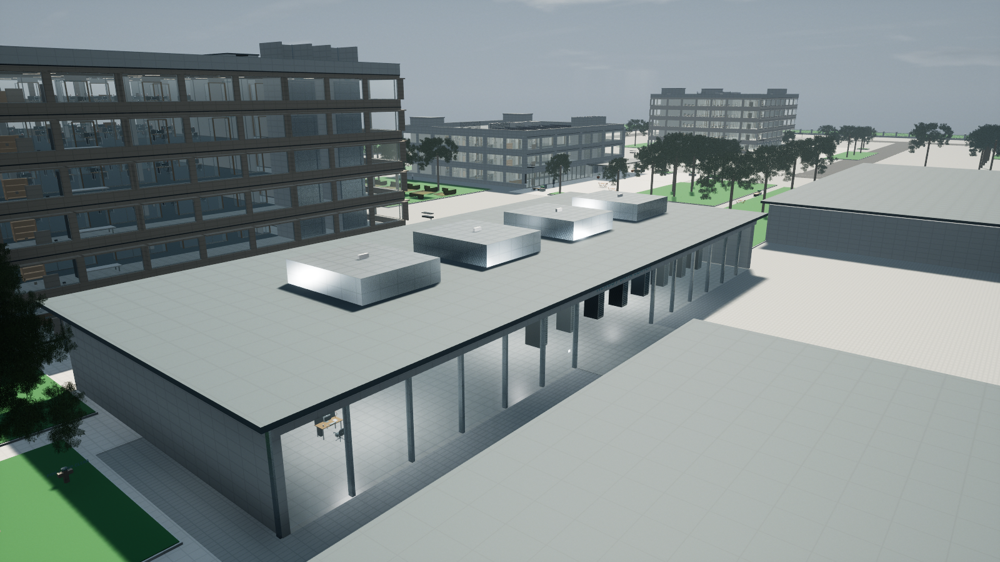
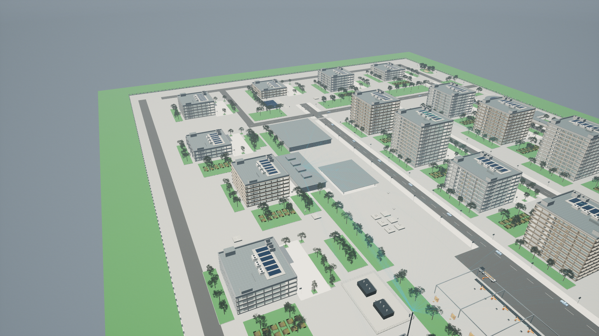
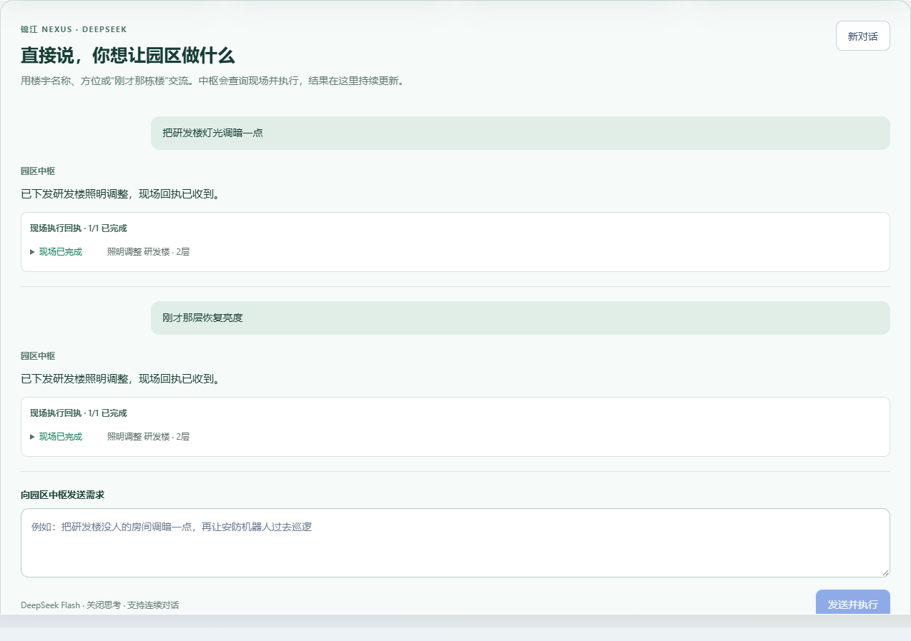

# 锦江超级园区 AIOS · Jinjiang Nexus

> 虚幻引擎 5 原生园区 + 本机 Node AI 中枢 + DeepSeek 自然语言调度
> 用一句中文调度一整座园区：*"把研发楼二层灯光调到六成，再开启智能节电"* —— 下一句 *"刚才那层恢复亮度"*。

本仓库是 **园区 AI 智控中枢（Web 控制台）** 的源码、构建产物、场景数据与验收记录。原生 UE 程序体积 1.7 GB，未纳入版本库。



## 目录

- [系统概览](#系统概览)
- [场景规模](#场景规模)
- [自然语言中枢怎么工作](#自然语言中枢怎么工作)
- [仓库包含什么](#仓库包含什么)
- [本地运行](#本地运行)
- [配置 DeepSeek](#配置-deepseek)
- [验收记录](#验收记录)
- [已知边界](#已知边界)

## 系统概览

| 层 | 技术 | 职责 |
| --- | --- | --- |
| 三维园区 | Unreal Engine 5.7 原生 x64 | 20 栋楼的实体场景、240 名骨骼职员、物流线、无人机、第一人称导览 |
| AI 中枢 | Node.js 24 + `node:sqlite` | HTTP API、会话与角色权限、工具调用编排、设备指令下发与回执追踪、审计 |
| 模型 | DeepSeek `deepseek-flash`（Chat Completions，`thinking: disabled`） | 连续对话、实体定位、多步任务规划、工具调用 |
| Web 控制台 | React 19 + Three.js（预构建于 `Hub/dist`） | F1 控制台、设备总账、告警、配送、沙盒编排；场景几何由 UE 实际导出 |

中枢负责**理解**，业务后端负责**校验**：模型给出的每个动作都要经过岗位权限、实体存在性、设备状态和楼层归属检查；没有实现的物理能力不会被伪装成已执行。模型不可用时明确报错，不退回关键词规则。

## 场景规模

| 指标 | 数量 |
| --- | --- |
| 规划范围 | 720 × 480 m（34.56 公顷，Demo 设计尺寸） |
| 楼宇 / 楼层 | 20 栋（3—12 层）/ 134 个使用楼层 |
| 独立照明分区 | 1,214 个（含 8 个食堂区域），6,638 套室内灯具 + 169 盏路灯 |
| 设备端点 | 33,181 个（灯具、电器、传感器统一编号） |
| 人员 | 240 名 Mixamo 骨骼职员，日程驱动待机 / 行走 / 坐下 / 打字 |
| 物流 | 16 件固定编号包裹、8 台 AMR、货梯跨层配送 |
| 空中物流 | 6 架配送无人机、12 处起降 / 接收坪 |
| 车辆 | 96 个车位（地面 + B1 地库）、24 辆停放车辆 |
| 通信 | 6 类通信节点、4 台安防巡检设备、278 个移动端点数据流 |



## 自然语言中枢怎么工作

1. **输入**：任意自然语言，可带楼宇别名、方位（"南侧第二栋"）、楼层、多步安排和连续指代。
2. **模型**：`deepseek-flash` 通过工具调用查询空间、设备、人员、访客、传感器状态，再组合照明、电器、空调、门禁、巡检、无人机、实物配送、火情演练等操作。
3. **校验**：后端按登录角色（超级管理员 / 园区管理员 / 运维 / 安保 / 审批 / 普通用户）复核每一次下发，越权或实体不存在直接拒绝。
4. **回执**：指令下发 → 虚幻场景执行 → 遥测回传，界面区分"已下发 / 现场执行中 / 现场已完成"。只有收到新任务编号与实物到架遥测，配送才显示完成。



## 仓库包含什么

```
Hub/
  backend/             AI 中枢后端源码（server / hub / llm / campus-assistant / campus-operations …）
  dist/                预构建 Web 控制台 + UE 导出的场景数据（campus-scene.json 34 MB）
  frontend/public/     场景与设备清单数据
  package.json
QA/                    Node 测试日志、模型连通与自然语言实测记录、界面回归、截图
ThirdPartyLicenses/    第三方组件许可
超级园区Demo说明.md     完整功能与场景说明（推荐先读）
超级园区素材署名.md     素材来源与授权说明
release-manifest.json  原始发布包文件清单与 SHA-256
使用说明.txt           最终用户操作说明（对应原生发布包）
```

**不在仓库内**：

| 内容 | 原因 |
| --- | --- |
| `Windows/`（UE 原生程序，1.7 GB） | 超过 Git 仓库合理体积 |
| `Runtime/node.exe`（91 MB） | 可由本机 Node 24 替代 |
| `Prerequisites/vc_redist.x64.exe`（18 MB） | 微软官方可下载 |
| `JinjiangNexus.exe` / `配置DeepSeek.exe` 启动器 | 原生包专用 |
| **任何 API 密钥** | `Hub/direct-deepseek.key` 已由 `.gitignore` 排除；仓库与提交历史中不含凭据 |

## 本地运行

需要 **Node.js 24 或更新版本**（使用内置 `node:sqlite`）。

```bash
cd Hub
node backend/server.mjs
```

打开 <http://127.0.0.1:8788/>，演示账号 `admin` / `Bailuwan2026!`（另有 `park` `ops` `security` `approver` `viewer`）。

健康检查：

```bash
curl http://127.0.0.1:8788/api/health
# {"ok":true,"revision":"nexus-native-integration","model":{"configured":false,...}}
```

未配置模型时，园区浏览、设备手动控制、告警与配送规则全部可用；自然语言中枢会返回明确的配置错误。`dist/` 是预构建产物，本仓库不含前端构建源码。

## 配置 DeepSeek

模型配置按优先级读取当前用户的私有文件（不在仓库内）：

`%USERPROFILE%\.jinjiang-nexus\model.json`

```json
{
  "mode": "model",
  "provider": "deepseek",
  "baseUrl": "https://api.deepseek.com",
  "model": "deepseek-flash",
  "protocol": "chat_completions",
  "apiKeyFile": "C:/Users/<你>/.jinjiang-nexus/Secrets/deepseek.key"
}
```

密钥文件只写一行 `sk-...`。**不要**把密钥写进仓库、截图或前端变量；接口调用计入你自己的 DeepSeek 账户。也兼容旧路径 `%LOCALAPPDATA%\JinjiangNexus\model.json`，或环境变量 `NEXUS_MODEL_CONFIG`。

## 验收记录

- Node 测试 **84 / 84 通过**（`QA/assistant-node-tests.log`）。
- 真实 DeepSeek 自然语言实测：`QA/natural_language_live.json`（包含"研发楼二层灯光 60% + 智能节电"的多步任务与后续指代）。
- 模型连通与配置回归：`QA/deepseek_connection.json`、`QA/model_setup_regression.json`、`QA/explorer_model_config_regression.json`。
- 原生包控件与规模核对：`QA/packaged_controls.json`（20 栋 / 240 人 / 1,214 分区 / 33,181 端点）。
- 界面与流程记录：`QA/*.md`、`QA/Visual/`。

## 已知边界

这是一个**可操作的演示系统**，不是生产交付：

- 人员、传感器读数、访客码、物流与无人机运动均为仿真；未接入真实摄像头、消防探测器、门禁或飞控。
- 照明节电按每灯 12 W 的演示假设估算，不是电表读数；通信流量是 UE 状态消息的 UTF-8 字节采样，不代表无线吞吐。
- 网页场景来自 UE 实际几何导出，材质与光照做了简化，画质不等同于原生端。
- 消防、无人机、工业设备的生产接入需独立验证；单机 SQLite 会话模型不适用于多用户部署。
- 未附开源许可证；素材授权见 `超级园区素材署名.md` 与 `ThirdPartyLicenses/`。对外使用前请先确认授权范围。

## 文档

- [超级园区Demo说明.md](超级园区Demo说明.md) — 场景、操作键位、物流与中枢能力的完整说明
- [超级园区素材署名.md](超级园区素材署名.md) — 素材来源与署名
- [使用说明.txt](使用说明.txt) — 原生发布包的最终用户说明
